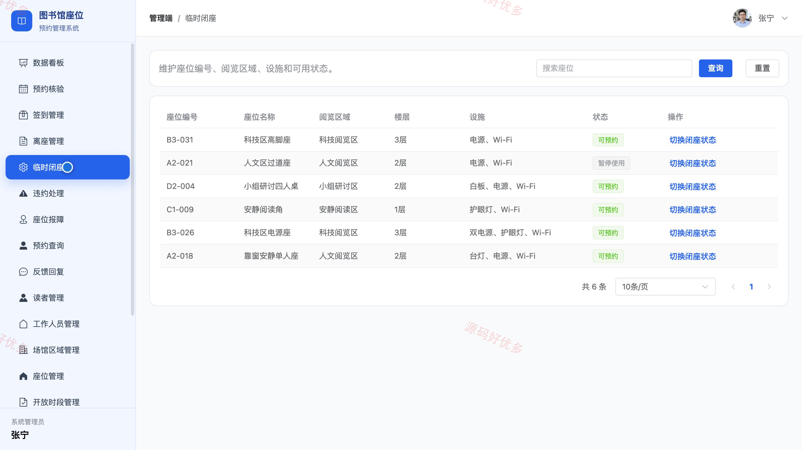
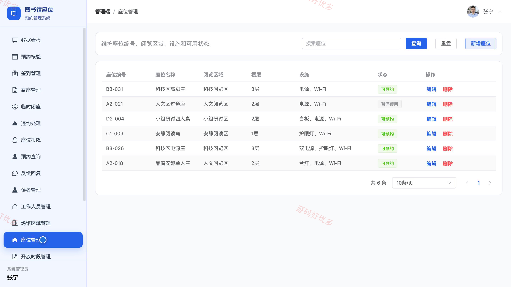

## 源码问题查看主页咨询

### 一、关键词
阅览室订座、座位预订、到馆签到、自习室管理、预约违约处理

### 二、作品包含
源码+数据库+万字设计文档+PPT+全套环境和工具资源+本地部署教程

### 三、项目技术
前端技术： Html、Css、Js、Vue3.4、Element-Plus、uniapp
后端技术：Java、SpringBoot3.2.0、MyBatis-Plus

### 四、运行环境要求
开发工具：IDEA/eclipse + VSCODE + HBuilder X + 微信开发者工具

数据库：MySQL5.7+（共13张表）

数据库管理工具：Navicat10以上版本

环境配置软件： JDK17 + Maven3.6

前端Nodejs：16+

浏览器：谷歌浏览器

### 五、项目介绍
项目编号：bs137B

图书馆座位预约小程序面向读者、图书馆工作人员和管理员。读者在小程序查询座位、预约时段并完成签到；工作人员在管理端核验预约、处理离座和报障；管理员维护场馆座位、预约规则及公告。

角色：读者、图书馆工作人员、管理员

读者功能：注册与登录、按区域和时段查询座位、在线预约座位、查看与取消预约、预约签到与结束使用、查看违约记录、查看公告与提交反馈、维护个人信息与登录密码。

图书馆工作人员功能：预约核验、签到管理、离座管理、临时闭座、违约处理、座位报障、预约查询、反馈回复。

管理员功能：读者与工作人员管理、场馆区域与座位管理、开放时段与预约规则管理、预约记录及异常处理、违约规则管理、公告管理、数据统计、个人账号管理。

### 六、运行截图

